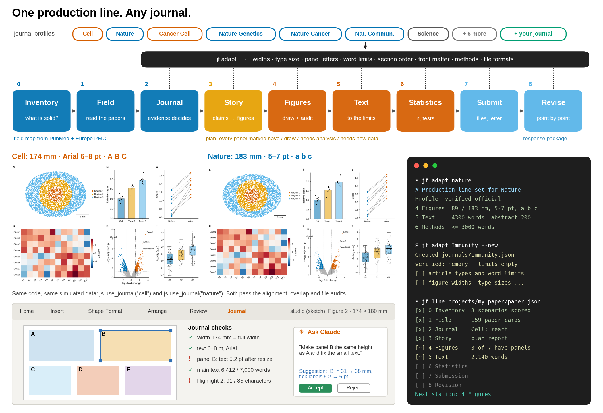
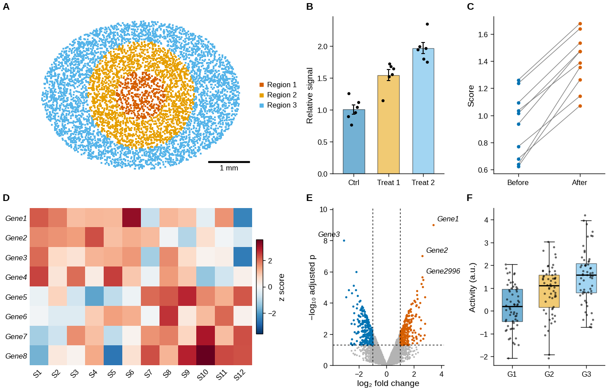
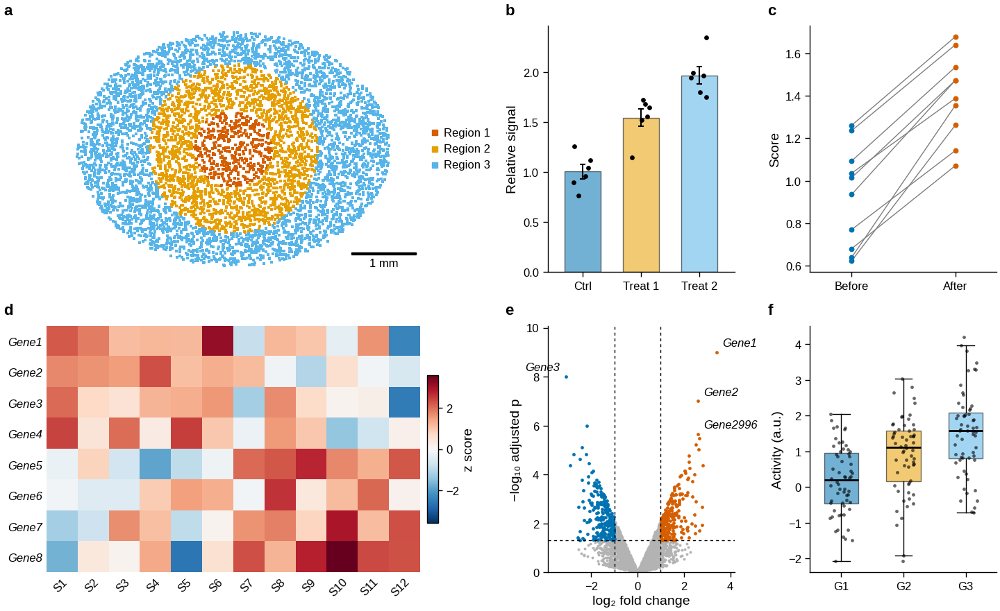

# JournalFactory

A paper factory for biology, run by Claude. Raw results go in at one end; a manuscript formatted for your journal comes out at the other. In between are nine stations: read the field, choose the journal from the evidence, plan the story and every figure, draw and audit the figures, write to the limits, check the statistics, package the submission, answer the reviewers. Name a journal, or let the evidence pick one, and the whole line resets to that journal's rules.



**Top:** journal profiles feed `jf adapt`, which sets stations 2–8. **Middle:** one script and one simulated data set, exported for Cell and for Nature. **Bottom:** a sketch of the built-in studio (drag panels in millimetres, live journal checks, Ask Claude, accept or reject suggestions). **Right:** example terminal output.

Claude knows it as the `journal-factory` skill; the command line is `jf`. [中文说明](README.zh-CN.md)

## Any journal

| You say | Run | What happens |
| --- | --- | --- |
| "for Nature" · "Cancer Cell" · "NC" | `jf adapt nature` | the built-in profile is loaded and every station is set to it |
| "which journal?" | `jf adapt auto --paper projects/<p>/paper.json` | journals are ranked by how your evidence meets their bar; the highest-tier one that fits is set up. If none fits, it says what is short and does not pick one anyway |
| a journal that is not built in | `jf adapt "Immunity" --new` | a draft profile is created from the publisher family: structure filled, every limit left empty, with the list of pages to read before formatting |

**Built in (13):** Cell · Cancer Cell · Cell Reports Medicine · Nature · Nature Genetics · Nature Cancer · Nature Medicine · Nature Biotechnology · Nature Methods · Nature Neuroscience · Nature Communications · Science · Neuro-Oncology.

What `jf adapt` changes, station by station:

| Station | Follows the journal |
| --- | --- |
| 2 Journal | the evidence bar your results are compared with |
| 3 Story | number of main display items; how extra figures are named (Figure S, Extended Data) |
| 4 Figures | widths, fonts, type size, panel-letter case, stroke range, resolution, file formats |
| 5 Text | word and character limits, section order, front matter (Highlights, eTOC, abstract form) |
| 6 Statistics | name and limit of the methods section |
| 7 Submission | required extras (reporting summary, key resources table, graphical abstract) |
| Studio | page sizes and the live checks in the Journal tab |

## The line

| # | Station | The question | Machines | Comes out |
| --- | --- | --- | --- | --- |
| 0 | Inventory | What do we have, and how solid is each result? | eight-dimension scoring, three scenarios | evidence table |
| 1 | Field | What does the field know, argue about and expect? | `jf field`: PubMed + Europe PMC search, paper cards, reference checks | field map (Markdown + browsable page) |
| 2 | Journal | Which journal fits now, and which after what extra work? | `jf fit`, `jf adapt` | fit table per scenario, line set for the journal |
| 3 | Story | One sentence, then claims, then figures | plan report; four marks per panel | plan with every gap showing |
| 4 | Figures | Build each figure to the journal's rules | `journal_style` (Python), `theme_cell` (R), templates, gates, `jf figure` | figure files that pass the audit |
| 5 | Text | Title to methods, in the journal's order and limits | studio, `jf count`, `jf cell text` | manuscript within limits |
| 6 | Statistics | Replicate unit, tests, what reviewers will ask | `jf cell legends` | statistics table, checklist |
| 7 | Submission | Cover letter, front matter, deposits, final files | guides, `jf cell refs` | submission folder |
| 8 | Revision | Reviewer reports to a plan and a reply | `jf cell response` | response package |

`jf line projects/<p>/paper.json` prints the nine stations for your paper, what exists at each, and the next one.

## What each station gives you

### Field research before you write (station 1)

You write the questions as PubMed queries; JournalFactory searches PubMed and Europe PMC, ranks the papers found by several queries first, reads them into paper cards, verifies every reference, and writes one page: what is known, what is argued about, and for each of your claims whether it is open, an extension, or already taken. The page is browsable, with links to the papers.

### A journal chosen by evidence (station 2)

Your results are scored 0–3 on eight dimensions (concept, technology, scale, orthogonal validation, replication, function, clinical relevance, resource) and compared with each journal's bar under three scenarios:

| Scenario | Question it answers |
| --- | --- |
| As it is | Where does the paper fit today? |
| Plus analysis | Where after work that needs no new data? |
| Plus new data | Where after the experiment you are considering? |

### A plan with the gaps showing (station 3)

Every main and extra figure, panel by panel, each with one of four marks, so a claim that still needs an experiment is never written as a result:

| Mark | Meaning |
| --- | --- |
| have | data and panel exist |
| draw | data exist, panel to be drawn |
| needs analysis | no new data needed |
| needs new data | experiment or cohort still to come |

### Figures that pass the audit (station 4)

The same ten lines draw for any journal:

```python
import sys; sys.path.insert(0, "scripts")
import journal_style as js

js.use_journal("nature")                                 # or "cell", "cancer-cell", "science", …
fig, axd = js.mosaic([["A", "A", "B"],
                      ["C", "D", "B"]], width="full", height_mm=120)   # 183 mm for Nature, 174 for Cell
js.templates.spatial_map(axd["A"], x, y, categories=region, pixel_um=10, bar_um=1000)   # scale bar included
js.templates.bar_points(axd["B"], {"Ctrl": ctrl, "Treated": treated}, ylabel="Signal (a.u.)")
js.label_panels(axd)                                     # a, b, c for Nature; A, B, C for Cell
js.save(fig, "out/Figure 1")                             # gates → files → audit
```

| Cell | Nature |
| --- | --- |
|  |  |

- **Eight templates:** bars with points, boxes with points, paired lines, volcano, heatmap, dot plot, stacked composition, spatial map.
- **Two gates before export:** panel edges aligned within 1.5 pt; no text touching other text. `save` refuses to export when either fails.
- **File audit after export**, with no extra dependencies: width, fonts and embedding, text size, stroke width, colour space, red with green, image resolution, file size.
- **R users:** `theme_cell()` and `save_cell_r()` for ggplot2 (Cell sizes).

```bash
bin/jf demo out/ --journal nature        # six-panel figure from simulated data, with the audit
bin/jf figure "Figure 2.pdf" --journal cancer-cell
```

### Text to the journal's limits (stations 5–8)

- `jf count manuscript.md --journal <id>`: words per section against the limits, for any journal.
- **cell-skills**, a full pack for the journal Cell, built the way [nature-skills](https://github.com/Yuan1z0825/nature-skills) is built (router → manifest → small core → references on demand → check scripts) with Cell's own rules:

  | Skill | What it does | Check |
  | --- | --- | --- |
  | `cell-figure` | Python and R styles, templates, gates, file audit, graphical abstract mode | `jf cell figure`, `jf cell demo` |
  | `cell-writing` | Title, Summary, Highlights, eTOC blurb, Introduction, Results, Discussion with Limitations, STAR Methods, legends, cover letter | `jf cell text` |
  | `cell-statistics` | Replicate unit, tests, what a legend must state, pseudoreplication in single-cell and spatial data | `jf cell legends` |
  | `cell-reviewer` | Read your own paper the way a referee and editor would | — |
  | `cell-response` | Revision plan, point-by-point response, revision cover letter, package consistency | `jf cell response` |
  | `cell-data` | Resource availability, key resources table, deposition, supplemental files | — |
  | `cell-citation` | Cell reference style and verification | `jf cell refs` |

- **Nature family, Cancer Cell and others:** bundled reference packs (`vendor/nature-skills`, `vendor/cancer-cell-skills`, `vendor/k-dense`) for writing conventions, reviewer view and reporting. `jf adapt` names the pack to open for your journal.

### A studio for the whole manuscript

`jf paper init <dir> --journal <id> --title "…"` creates one editable page per manuscript part at the journal's sizes: main text, front matter, each main and extra figure, the graphical abstract.

- **Canvas:** drag and resize panels in millimetres, snap to a 1 mm grid, align and distribute, crop, group, lock, undo, versions.
- **Text:** edit in place, PowerPoint-style ribbon, word counts against the journal's limits.
- **Journal tab:** the page checked against the target journal while you work.
- **Ask Claude:** select anything, or drag a screenshot region, and ask or request an edit; the answer comes from your Claude session, with the project's context. Claude's changes to your prose arrive as suggestions you accept or reject.
- **Export:** PDF and PNG at the exact page size.

### Schematics without image generators

Local [BioCartoon](https://github.com/josephrich98/biocartoon) icon search (`jf cartoon`) and a hand-written SVG guide for workflow drawings and graphical abstracts. Research images are never created or altered by generative tools.

## Install

**Claude Code:**

```bash
git clone https://github.com/yufchen723/JournalFactory ~/.claude/skills/journal-factory
~/.claude/skills/journal-factory/bin/jf doctor
```

Then talk to Claude: "set this up for Nature Genetics", "which journal fits this project?", "learn the field first", "plan the figures", "check Figure 2", "write the abstract", "where are we?".

**Needs:** Python ≥ 3.9. The figure code needs matplotlib, numpy and Pillow (R: ggplot2 and patchwork). Everything else is standard library.

**Optional:**

```bash
# BioCartoon icons, kept in a private environment inside the skill
python3 -m venv tools/biocartoon_env && tools/biocartoon_env/bin/pip install biocartoon==0.4.10
```

PDF and PNG export from the studio uses Playwright with Chromium, installed on first use.

## Commands

```
jf line projects/<p>/paper.json             the nine stations for one paper, and the next one
jf adapt <journal> | auto --paper … | "<new>" --new    set the whole line for a journal
jf journals | journal <id> | compare <ids>  journal profiles and limits
jf fit projects/<p>/paper.json              evidence against each journal's bar, per scenario
jf field init|scan|merge|verify|html <slug> learn a field from its papers
jf figure <files> --journal <id>            audit figure files
jf demo <out> --journal <id>                demo figure in a journal's style (simulated data)
jf count <text.md> --journal <id>           words per section against the limits
jf paper init <dir> --journal <id> --title "…"   manuscript workspace in the studio
jf studio --studio <dir>/.studio start      open the studio
jf cell figure|demo|text|legends|response|refs   Cell checks
jf cartoon search|get|fetch …               BioCartoon icons (local catalogue)
jf doctor                                   what is installed, what is missing
```

## How sure are the journal numbers?

Every profile in `journals/` records how its limits were checked, and `jf adapt` prints it first:

| Level | Meaning | Built-in profiles |
| --- | --- | --- |
| `official` | read on the journal's own author pages, with the date | Cell, Nature, Nature Genetics, Nature Cancer |
| `secondary` | from other sources that agree | Cancer Cell |
| `memory` | not yet checked: use to plan and draft, confirm before formatting | the other eight, and every profile made with `--new` |

- Cell's rules are summarised, with the source of each, in [`cell-skills/cell-shared/journal-formats/cell.md`](cell-skills/cell-shared/journal-formats/cell.md) (read 2026-11-18). Three documents were not read and are marked as such: the STAR Methods author guide PDF, the journal-policies page and the final file requirements PDF.
- A profile made with `--new` never invents a limit: they stay empty until you or Claude read the journal's pages. Its figure rules and evidence bar are the publisher family's and are labelled as placeholders.
- Evidence bars are a reading of recently published papers, not journal policy.
- Journals change their rules. Read their pages again before final files.

## Privacy and data

- **Your project stays on your computer.** Nothing about your data, patients or unpublished results is sent anywhere by the scripts. This repository ships with `projects/` and `fields/` empty.
- **Literature search** contacts PubMed, Europe PMC, iCite and bioRxiv with the search terms you wrote in `queries.tsv`, and nothing else.
- **The studio** listens on 127.0.0.1 only, behind a token.
- **Research images are never altered by generative tools.** Schematics only, and BioCartoon runs from its local catalogue; its upload commands are switched off.
- **Bundled skills are reference text.** Their installers, update hooks and scripts that call paid or outside services are not run.
- No data is sent to the author of this skill.

## Files

| Path | What it is |
| --- | --- |
| `SKILL.md` | what Claude reads first: stations, rules, commands |
| `references/` | one guide per station, plus journal adaptation, the studio and the skills catalogue |
| `journals/` | journal profiles: limits, figure rules, evidence bar, how verified |
| `scripts/journal_style.py` | the figure kit for any journal |
| `cell-skills/` | the Cell skill pack ([README](cell-skills/README.md)) |
| `scripts/`, `bin/` | `jf`, PubMed and Europe PMC helpers |
| `studio/` | the built-in editor for text and figures |
| `templates/` | field queries, paper card, field-map page |
| `vendor/` | pinned outside skills with their licences |
| `fields/`, `projects/` | your field maps and paper files (empty here) |

## Credits

- **[nature-skills](https://github.com/Yuan1z0825/nature-skills)** (Apache-2.0): bundled in `vendor/`, and the architecture that `cell-skills` follows. See [`cell-skills/NOTICE.md`](cell-skills/NOTICE.md).
- **[Awesome-Journal-Skills](https://github.com/brycewang-stanford/Awesome-Journal-Skills)** (MIT): Cell-Skills and Cancer-Cell-Skills checklists.
- **[claude-scientific-skills](https://github.com/K-Dense-AI/claude-scientific-skills)** by K-Dense (MIT): scientific visualization, venue templates, scientific writing, peer review.
- **[BioCartoon](https://github.com/josephrich98/biocartoon)** (BSD-2-Clause; icons carry their own licences): icon guides.
- **[schematic-figure](https://github.com/lgwrightlab/schematic-figure)** (MIT): SVG schematic guide.
- **[PaperLens](https://github.com/yufchen723/PaperLens)** (MIT): reading one paper in depth.
- The palette is the Okabe–Ito colour-blind-safe set. Journal rules are summarised from the journals' own author pages, which remain the authority.

Sources, commits and what was left out of each bundle: [`references/10_skills_catalogue.md`](references/10_skills_catalogue.md).

## License

MIT for JournalFactory's own text and code, see [LICENSE](LICENSE). Everything under `vendor/` keeps its own licence.
