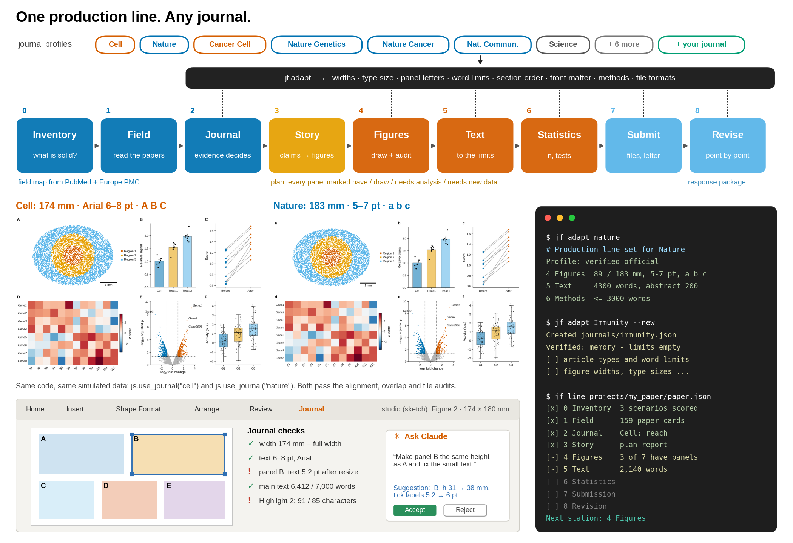

# JournalFactory

用 Claude 把一个生物学课题从数据做到投稿。你告诉它手里有什么，JournalFactory 先读文献了解领域，再按证据选期刊，规划故事线和每一张图，然后按目标期刊自己的规范帮你画图、写稿，每条规范都有脚本检查，并注明出处。



**上：** 九个阶段。**左：** 用自带模板画的一张 Cell 全幅图（模拟数据）。**右：** 检查命令的输出示例。

在 Claude 里它是 `journal-factory` 这个 skill，命令行是 `jf`。[English](README.md)

## 你会得到什么

- **动笔之前的领域地图。** 按你写的检索式查 PubMed 和 Europe PMC，把论文读成卡片，逐条核对参考文献，汇成一页：领域已知什么、在争什么、你的哪些结论是空白、延伸，还是已被别人做了。
- **按证据而不是按愿望选期刊。** 13 个期刊档案（Cell、Nature、Nature Genetics、Nature Cancer、Cancer Cell、Nature Communications 等）。把你的结果在 8 个维度上打分，和每个期刊的门槛对比，分三种情景：现在投、只补分析、补新数据。
- **每张图的计划，缺口一目了然。** 每个面板标四种状态之一：已有、有数据待画、需要分析、需要新数据。还缺实验的结论不会被写成结果。
- **cell-skills：一整套 Cell 期刊 skill。** 结构照 [nature-skills](https://github.com/Yuan1z0825/nature-skills) 的做法，规范用 cell.com 上读到的官方要求：

  | Skill | 做什么 | 检查命令 |
  | --- | --- | --- |
  | `cell-figure` | Python 和 R 两套样式（85 / 114 / 174 mm，Arial 6–8 pt，大写面板字母）；8 个图模板；对齐和文字重叠检查；导出文件检查；graphical abstract | `jf cell figure`、`jf cell demo` |
  | `cell-writing` | 标题、Summary、Highlights、eTOC、引言、结果、讨论与局限、STAR Methods、图注、cover letter | `jf cell text` |
  | `cell-statistics` | 重复单位、检验、图注必须写的统计信息、单细胞和空间数据的假重复 | `jf cell legends` |
  | `cell-reviewer` | 按 Cell 审稿人和编辑的角度自审 | — |
  | `cell-response` | 返修计划、逐条回复、返修 cover letter、全稿一致性 | `jf cell response` |
  | `cell-data` | Resource availability、key resources table、数据存放、补充文件 | — |
  | `cell-citation` | Cell 参考文献格式和核对 | `jf cell refs` |

- **内置编辑器。** 稿件每个部分一页：正文、前置材料、每张图、graphical abstract。按毫米拖动面板，原地改字，选中任何内容问 Claude，接受或拒绝它的修改建议。
- **不用图像生成器的示意图。** 本地 BioCartoon 图标检索和手写 SVG 指南。

## 九个阶段

| # | 阶段 | 要回答的问题 |
| --- | --- | --- |
| 0 | 盘点 | 手里有什么，每个结果有多扎实？ |
| 1 | 领域 | 领域已知什么、争什么、期待什么？ |
| 2 | 期刊 | 现在适合哪本，补了什么之后适合哪本？ |
| 3 | 故事 | 一句话，然后论点，然后图 |
| 4 | 图 | 按期刊的尺寸、字体、颜色规范画每张图 |
| 5 | 文字 | 按期刊的顺序和字数写 |
| 6 | 统计 | 重复单位、检验、审稿人会问什么 |
| 7 | 投稿 | cover letter、前置材料、数据存放、最终文件 |
| 8 | 返修 | 从审稿意见到计划和逐条回复 |

## 安装

```bash
git clone https://github.com/yufchen723/JournalFactory ~/.claude/skills/journal-factory
~/.claude/skills/journal-factory/bin/jf doctor
bin/jf cell demo out/          # 不需要任何数据：用模拟数据画一张 6 面板图并检查
```

需要 Python ≥ 3.9；画图代码需要 matplotlib、numpy、Pillow（R 版需要 ggplot2 和 patchwork）。

## 期刊规范有多可靠

`journals/` 里每个档案都记录了数值是怎么核对的：`official`（在期刊官网读到，带日期）、`secondary`（其他来源一致）、`memory`（尚未核对）。Cell 是 `official`，2026-11-18 读取，汇总在 [`cell-skills/cell-shared/journal-formats/cell.md`](cell-skills/cell-shared/journal-formats/cell.md)。期刊会改规范，最终排版前请再看一次官网。

## 隐私

- 你的课题、数据和未发表结果不会被脚本发到任何地方；本仓库的 `projects/` 和 `fields/` 是空的。
- 文献检索只把你写的检索词发给 PubMed、Europe PMC、iCite 和 bioRxiv。
- 编辑器只监听本机 127.0.0.1，带令牌。
- 科研图像不用生成式工具改动。

## 致谢与许可

致谢、来源和许可见 [README.md](README.md#credits)。JournalFactory 自己的文字和代码为 MIT 许可；`vendor/` 下的内容保留各自的许可。
